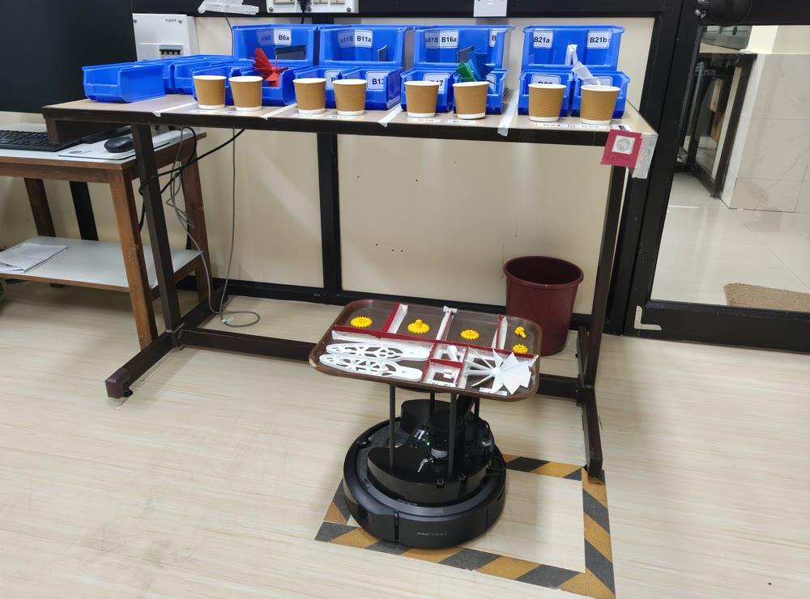
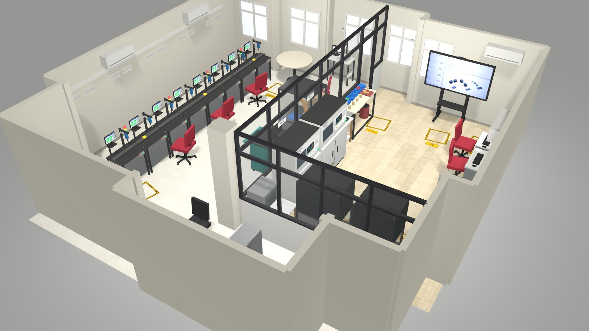
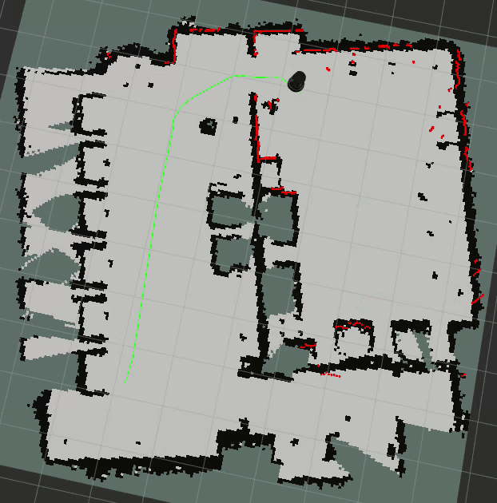
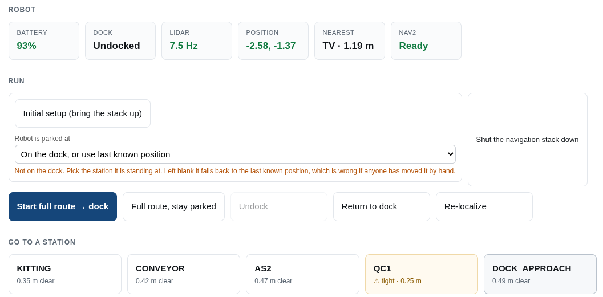
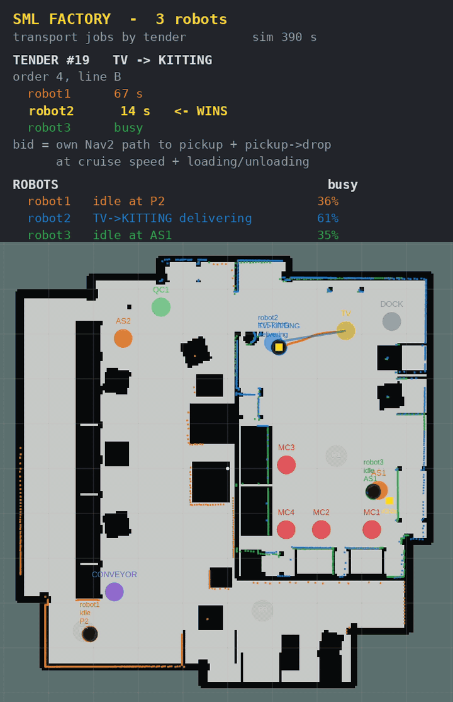
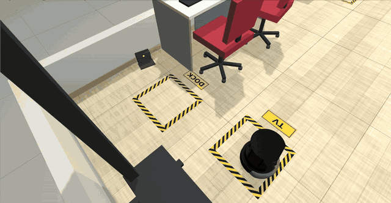
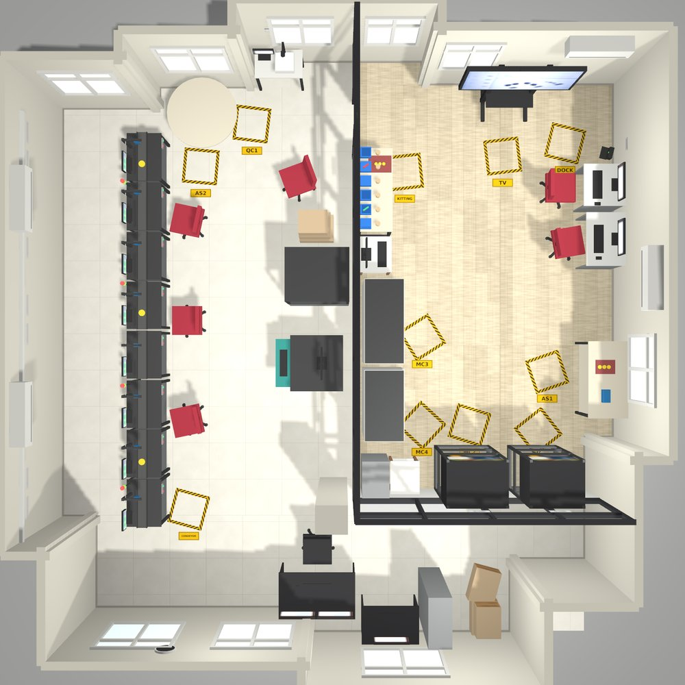

# Autonomous material transport with a SLAM-based mobile robot

My Dual Degree Project (M.Tech. thesis) at IIT Bombay, July 2026 to present.

A TurtleBot 4 runs the trolley trips of a fan assembly line on its own, and a Gazebo copy of the
line lets several robots share those trips.

*Photo: the real robot at the kitting station of the line, carrying a tray of fan parts.*

*The Gazebo copy of the line.*

## What I built

- The robot software on ROS 2 Jazzy, with Nav2 and SLAM Toolbox: state estimation, planning,
  control and actuation, on a TurtleBot 4 (Create 3 base, Raspberry Pi 4B, RPLIDAR A1M8)
- A lidar map of the line with its stations, and a startup that checks each stage before the robot
  moves
- A tuned Nav2 MPPI controller, retries when a station is missed, infrared docking and battery
  limits
- A web panel so lab staff can run the robot without a terminal
- A Gazebo simulation of the line in which three robots share the transport jobs

*The real robot in RViz, on its lidar map of the line, driving the last stops of a route (conveyor,
AS2, QC1 and TV) and back to its dock. Red: the live lidar scan. Green: the planned path. Screen
recording, 12 times real speed.*

*The web panel for lab staff (screenshot): live robot status, the route buttons and the first row
of station buttons, each with its clearance.*

*The Gazebo simulation, where three robots share the transport jobs. Top: the dispatcher's live
tender board. Each free robot bids the time the job would take it, from its own Nav2 path at
cruise speed plus loading and unloading, and the lowest bid wins. Bottom: the same moment in RViz,
with each robot's job and the paths the robots planned. Screen recording, robots at about 5.6
times real speed.*

*Gazebo, with the walls cut down for filming. The camera follows one robot at the TV station and
then to the kitting station. Screen recording, robots at about 5 to 6 times real speed.*

## Results

- 12 route trials scored from the robot's own logs: 100 of 112 station visits reached
- Fleets of 1 to 6 robots in an earlier 2D simulation on the real map: output rose from 21.9 to
  47.9 fans an hour

## Code

The code is private for now. Write to me if you would like to know more about the project.
